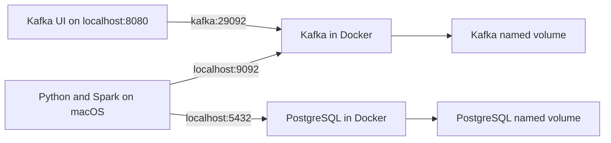

# Multi-Exchange Crypto Analytics Platform

A zero-cost learning project that normalizes public Binance and MEXC trade
streams through Kafka and processes them with Spark Structured Streaming. The
Phase 1 product will serve cross-exchange analytics from PostgreSQL to Streamlit.

The detailed build plan is maintained locally outside version control.

## Current status

Phase 1A establishes the contracts and infrastructure. It includes:

- Kafka 4.3.1 in single-broker KRaft mode
- Kafbat Kafka UI
- PostgreSQL 17 with persistent local storage
- Versioned PostgreSQL migrations
- A version-2 canonical trade contract shared by Binance and MEXC
- Binance JSON and MEXC Protobuf offline fixtures
- Generated MEXC Protobuf decoding code
- PySpark 4.0.3 with explicit Kafka schemas

There is no live producer, Spark aggregation job, PostgreSQL sink, or dashboard
yet. Those are delivered in later phases.

## Current topology



Host applications use loopback ports. Containers use Docker service names on the
Compose network.

## Prerequisites

- Docker Desktop
- Homebrew Python 3.11
- Homebrew OpenJDK 17
- GNU Make

The application is written in Python. Java 17 is required by Spark's JVM runtime.

## Phase 1A setup

```bash
cp .env.example .env
make install
make proto
make check
make infra-up
make db-status
make db-migrate
make topics
```

Kafka UI is available at <http://localhost:8080>. PostgreSQL listens only on
`localhost:5432`.

Use `make infra-down` for a normal shutdown. It preserves both named volumes.
Deleting volumes is intentionally not part of the standard workflow.

## Repository map

| Path | Responsibility |
|---|---|
| `common/` | Canonical models, settings, and logging |
| `producer/adapters/` | Pure exchange-payload mapping; live connections come next |
| `producer/proto/` | Pinned MEXC schema provenance and local decoder schema |
| `producer/generated/` | Mechanically generated Protobuf module |
| `streaming/` | Spark wire schema; processing job comes later |
| `migrations/` | Immutable PostgreSQL schema changes |
| `scripts/` | Migrations and compatibility checks |
| `tests/fixtures/` | Captured public exchange messages for offline tests |
| `docs/` | Decisions, contracts, evidence, and learning notes |

## Local limitations

- One Kafka broker and replication factor one provide no broker-failure
  tolerance.
- Kafka and PostgreSQL use plaintext listeners bound to the local machine.
- Exchange market feeds are public but still use encrypted `wss://` transport.
- Kafka producer idempotence, Spark checkpoints, and database upserts will reduce
  duplicates at different boundaries; the project will not claim universal
  exactly-once delivery.
