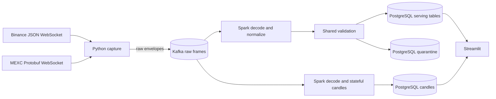

# Multi-Exchange Crypto Analytics Platform

A local MVP that streams configured public spot trades from Binance and MEXC into a
live dashboard. Original market frames are captured in Kafka before decoding.
Spark Structured Streaming normalizes and validates them, then writes
PostgreSQL serving tables for Streamlit.

No exchange account or API key is required.

## What you can see

The dashboard currently shows:

- Latest Binance and MEXC trade prices
- Signed price difference and symmetric spread in basis points
- A live UTC price chart for both exchanges
- Recent price, quantity, and trade-side observations
- Feed freshness and Spark batch health
- One-minute candlesticks and base-asset volume, selectable by exchange
- Candle trade count, revision, UTC boundaries and developing/final status

The separate candle query computes deduplicated one-minute OHLCV snapshots in
PostgreSQL; the dashboard only reads them. Stale updates are labelled, and a
final candle does not imply complete capture history. VWAP, volatility and
larger intervals remain future work.

## Architecture



Kafka and PostgreSQL run in Docker. The producer, Spark job, and dashboard run
from the local Python environment.

## Stack

- Python 3.11
- Apache Kafka 4.3.1 in single-broker KRaft mode
- Spark Structured Streaming 4.0.3
- PostgreSQL 17
- Streamlit and Altair
- Docker Compose and Kafbat Kafka UI

Java 17 is required because PySpark runs on the Spark JVM.

## Run the MVP

Prerequisites: Docker Desktop, Homebrew Python 3.11, Homebrew OpenJDK 17, and
GNU Make.

Prepare the project:

```bash
cp .env.example .env
cp config/feeds.example.yaml config/feeds.yaml
make install
make proto
make check
```

Start the local services and apply the database migrations:

```bash
make infra-up
make db-migrate
make topics
```

Check the configured feeds without connecting to Kafka or an exchange:

```bash
make ingestion-plan
```

Open three terminals in the repository and run one command in each:

```bash
make ingestion
```

```bash
make live-pipeline
```

```bash
make dashboard
```

Open <http://127.0.0.1:8501>. Kafka UI is available at
<http://127.0.0.1:8080>.

Use `Ctrl+C` to stop each application process. Stop the Docker services without
deleting their named volumes with:

```bash
make infra-stop
```

## Choose markets

Edit the ignored local file `config/feeds.yaml`:

```yaml
version: 1
exchanges:
  binance:
    transport: websocket
    market_type: spot
  mexc:
    transport: websocket
    market_type: spot
watchlists:
  - name: major-pairs
    exchanges: [binance, mexc]
    pairs: [BTC/USDT, ETH/USDT]
    feeds: [trades]
```

This expands into four logical feeds. Each has one WebSocket connection and an
independent reconnect supervisor; all share one Kafka publishing client in one
Python process. There is a limit of 20 feeds per process, not 20 pairs per venue.
Adding feeds does not create brokers, topics, or additional Spark jobs.

Configuration is validated before any network connection. Unknown fields,
unsupported venues/transports, malformed pairs, and overlapping feeds are
rejected. Pair names are normalized to uppercase. Validation does not check
whether an instrument is currently listed on an exchange. Only Binance/MEXC
spot trade feeds are implemented; quotes, REST polling, and live reload are not.
Restart ingestion to apply changes.

Use `make ingestion FEEDS_CONFIG=path/to/feeds.yaml` for another file. With no
CLI flags, `python -m ingestion.main` reads `config/feeds.yaml`; a missing file
is an error. Explicit `--source binance|mexc|both` instead uses `MARKET_SYMBOLS`
from `.env` and cannot be combined with `--config`. Connection endpoints and
operational settings stay in `.env`.

Spark and PostgreSQL already handle the configured symbols through the same
trade contract. The dashboard still displays one symbol: set `DASHBOARD_SYMBOL`
in `.env` and restart it to switch. An interactive watchlist selector is future work.

## Useful development commands

Consume all Kafka records available after the inspection checkpoint, then exit:

```bash
make spark-consumer-once
```

Write all records available after the PostgreSQL checkpoint, then exit:

```bash
make live-pipeline-once
```

Run one-minute candles separately from the trade-serving query:

```bash
make db-migrate
make candles
```

For a bounded run that processes available input and exits:

```bash
make candles-once
```

This reads the same raw Kafka topic and writes `raw_market.candles`, with its
own `checkpoints/candles-1m-postgres-v1` directory. It does not replace the
existing trade pipeline. The dashboard's candle section reads these results
for `DASHBOARD_SYMBOL`, with a Binance/MEXC selector. To refresh both trade and
candle views, run ingestion, the live trade pipeline, candles and the dashboard
in separate terminals. Do not delete only the candle
checkpoint: the writer rejects a new checkpoint against existing candle output.

`CANDLE_WATERMARK_DELAY_SECONDS` defaults to 120 seconds; this is a provisional
lateness allowance, not a dashboard delay. Updates follow the Spark trigger.
Watermark progress follows observed trade time, so a bounded run or idle input
can leave recent candles developing. Starting mid-window or missing trades
does not produce complete exchange history, even when a candle is finalized.
The processor retains trade IDs per active candle; only a limited local
synthetic load check has been performed. Five-minute processing and larger
rollups are not wired yet.

Publish a small sample from every configured exchange/symbol feed:

```bash
.venv/bin/python -m ingestion.main --max-frames 5
```

The limit counts captured frames separately for each feed. A MEXC frame can
contain several trades, so Spark may produce more trade rows than captured frames.
`--max-events` remains a compatibility alias but now also counts frames. A quiet feed may take time to reach its limit; `Ctrl+C`
stops the whole process and flushes outstanding Kafka deliveries.

Capture a malformed offline frame, then let Spark quarantine it:

```bash
make raw-quarantine-smoke
make live-pipeline-once
```

Run formatting, linting, strict typing, and tests:

```bash
make check
```

## Data and recovery

The default topic is `raw-market-frames-v1`. Each versioned JSON envelope
contains subscription identity, receipt time, a capture ID, and the original
payload: text unchanged, binary losslessly Base64-encoded. Ingestion does not
parse trade prices, quantities, symbols, or exchange timestamps from payloads.
It still owns connection/subscription/control-message handling.

Spark decodes provider messages inside Python workers using the pinned
decoders, expands MEXC deal arrays, and applies shared canonical validation.
This favors parity and reuse over native Spark decoding; worker overhead is a
known scaling consideration. Invalid input is recorded in
`raw_market.rejected_frames` in the same transaction as batch evidence.

The serving query uses `checkpoints/raw-market-postgres-v1` and the
`raw_market` SQL schema. Frame locations include a sub-event index because
one Kafka record may contain several trades. Stable event IDs deduplicate trade
inserts; processed counters count valid input events, not only unique inserts.
The sink uses `COPY`, merges latest prices, updates counters, records a batch
marker, and prunes recent rows in one PostgreSQL transaction.

A database guard binds the query to its Spark checkpoint UUID. A mismatched
history fails rather than silently matching old batch IDs. Do not edit/reset
checkpoints or markers independently. Replay tests should use an isolated
database and checkpoint; do not point two writers at the same checkpoint.
Raw input uses `failOnDataLoss=true`: expired offsets fail rather than silently
skip captured data. Kafka retention is 24 hours, not a permanent archive.

No intermediate canonical Kafka topic or archive is required. The source-reader
boundary produces a defined raw-frame DataFrame shape, keeping processing
separate from Kafka reads. File/S3 readers and an archive writer are not implemented.

### Existing installations

Run `make infra-up` to apply the updated topic initializer, then
`make db-migrate` for the additive raw-serving schema. No old topic, table, or
checkpoint needs deletion. The default pipeline and dashboard now use raw mode.

`raw-trades`, `raw-trades-dlq`, the `analytics` schema, and the old
`checkpoints/live-market-postgres` remain legacy state. To inspect/serve that
canonical input explicitly:

```bash
SERVING_MODE=canonical make live-pipeline-once
SERVING_MODE=canonical make dashboard
```

Ingestion always captures raw frames; `SERVING_MODE` selects processing and
dashboard behavior, not the producer's wire format. The legacy sink retains its
older checkpoint-reset hazard. Keep it intact rather than resetting it.
The new diagnostic inspection query has its own checkpoint
`raw-frame-inspection-v1`.

See [the data contract](docs/data-contracts.md) and
[architecture decisions](docs/decisions.md) for the detailed rules and
trade-offs.

Opt-in sink integration tests create and remove a uniquely named temporary
database, leaving the configured application's tables untouched:

```bash
RUN_POSTGRES_INTEGRATION=1 .venv/bin/python -m pytest tests/processing/spark/test_raw_sink.py
```

## Repository layout

| Path | Purpose |
|---|---|
| `ingestion/` | Feed planning, worker supervision, metrics, and Kafka publishing |
| `config/feeds.example.yaml` | Watchlist template; copy to ignored `config/feeds.yaml` |
| `ingestion/connectors/` | Exchange sockets, subscriptions, control messages, and heartbeat logic |
| `processing/decoders/` | Provider decoding, normalization, and pinned MEXC Protobuf sources/decoder |
| `processing/spark/` | Spark session, raw source boundary, worker normalization, validation, and PostgreSQL writes |
| `dashboard/` | Streamlit page and PostgreSQL queries |
| `common/` | Shared configuration and logging |
| `common/contracts/` | Raw capture envelopes, canonical trades, legacy failures, and shared field types |
| `migrations/` | Versioned PostgreSQL schema changes |
| `tests/fixtures/` | Captured exchange messages for offline tests |
| `docs/` | Data contracts, decisions, and validation notes |

The older `make producer`, `producer-binance`, and `producer-mexc` commands
retain environment-based market selection, not YAML selection. Python module
paths have moved to `ingestion` and `processing.spark`. Kraken, OKX, and quote
feeds are not implemented yet.

## MVP boundaries

- The single Kafka broker and replication factor of one are for local
  development, not high availability.
- Local service listeners are plaintext and bound only to loopback interfaces;
  exchange feeds use encrypted `wss://` connections.
- PostgreSQL holds a bounded dashboard projection, not a permanent raw archive.
- Producer idempotence, Spark checkpoints, and database upserts reduce
  duplicates at different boundaries. The project does not claim universal
  exactly-once delivery.
