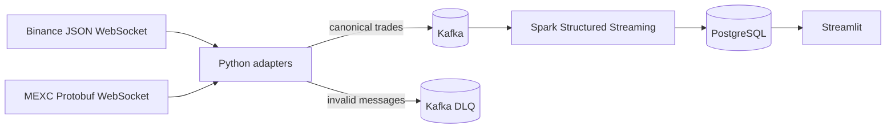

# Multi-Exchange Crypto Analytics Platform

A local MVP that streams public BTCUSDT trades from Binance and MEXC into a
live dashboard. Exchange messages are normalized into one contract, buffered in
Kafka, validated by Spark Structured Streaming, and served from PostgreSQL to
Streamlit.

No exchange account or API key is required.

## What you can see

The dashboard currently shows:

- Latest Binance and MEXC trade prices
- Absolute price difference and symmetric spread in basis points
- A live UTC price chart for both exchanges
- Recent price, quantity, and trade-side observations
- Feed freshness and Spark batch health

This is the first usable end-to-end version. One-minute candles, VWAP, volume,
trade count, volatility, and event-time deduplication are still being built.

## Architecture



Kafka and PostgreSQL run in Docker. The producer, Spark job, and dashboard run
from the local Python environment.

## Stack

- Python 3.11
- Apache Kafka 4.3.1 in single-broker KRaft mode
- Spark Structured Streaming 4.0.3
- PostgreSQL 17
- Streamlit and Altair
- Docker Compose and Kafbat Kafka UI

Java 17 is required because PySpark runs on the Spark JVM.

## Run the MVP

Prerequisites: Docker Desktop, Homebrew Python 3.11, Homebrew OpenJDK 17, and
GNU Make.

Prepare the project:

```bash
cp .env.example .env
make install
make proto
make check
```

Start the local services and apply the database migrations:

```bash
make infra-up
make db-migrate
make topics
```

Open three terminals in the repository and run one command in each:

```bash
make producer
```

```bash
make live-pipeline
```

```bash
make dashboard
```

Open <http://127.0.0.1:8501>. Kafka UI is available at
<http://127.0.0.1:8080>.

Use `Ctrl+C` to stop each application process. Stop the Docker services without
deleting their named volumes with:

```bash
make infra-stop
```

## Useful development commands

Consume all Kafka records available after the inspection checkpoint, then exit:

```bash
make spark-consumer-once
```

Write all records available after the PostgreSQL checkpoint, then exit:

```bash
make live-pipeline-once
```

Publish a small sample from both public feeds:

```bash
.venv/bin/python -m producer.main --source both --max-events 5
```

Exercise the producer dead-letter path with a malformed offline fixture:

```bash
make producer-dlq-smoke
```

Run formatting, linting, strict typing, and tests:

```bash
make check
```

## Data and recovery

Both exchanges publish versioned JSON events to `raw-trades` using keys such as
`binance:BTCUSDT`. Prices and quantities stay as decimal strings on Kafka and
are cast only after Spark validation. Invalid source messages go to
`raw-trades-dlq`.

Spark keeps separate checkpoints for the inspection and PostgreSQL queries.
Restarting a query resumes from its recorded Kafka offsets. PostgreSQL stores
the latest trade per exchange and a rolling one-hour trade buffer for the chart;
Kafka remains the retained replayable event log.

The inspection query fails if a checkpoint references offsets that have expired
from Kafka. The live dashboard query logs the gap and resumes from the oldest
retained offset instead. That availability trade-off is limited to the bounded
dashboard projection and does not reconstruct the missing events.

The PostgreSQL sink stages each Spark micro-batch with `COPY`, then merges live
trades, latest prices, freshness, and batch evidence in one transaction. Stable
event IDs and Kafka positions make retries idempotent at this boundary.

See [the data contract](docs/data-contracts.md) and
[architecture decisions](docs/decisions.md) for the detailed rules and
trade-offs.

## Repository layout

| Path | Purpose |
|---|---|
| `producer/` | Exchange clients, adapters, supervision, and Kafka publishing |
| `streaming/` | Spark decoding, validation, checkpoints, and PostgreSQL writes |
| `dashboard/` | Streamlit page and PostgreSQL queries |
| `common/` | Configuration, logging, and canonical models |
| `migrations/` | Versioned PostgreSQL schema changes |
| `tests/fixtures/` | Captured exchange messages for offline tests |
| `docs/` | Data contracts, decisions, and validation notes |

## MVP boundaries

- The single Kafka broker and replication factor of one are for local
  development, not high availability.
- Local service listeners are plaintext and bound only to loopback interfaces;
  exchange feeds use encrypted `wss://` connections.
- PostgreSQL holds a bounded dashboard projection, not a permanent raw archive.
- Producer idempotence, Spark checkpoints, and database upserts reduce
  duplicates at different boundaries. The project does not claim universal
  exactly-once delivery.
