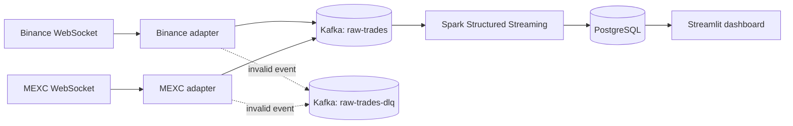

# Multi-Exchange Crypto Analytics Platform

A local, near-real-time market analytics system built from public Binance and
MEXC WebSocket feeds. It normalizes exchange-specific messages into a shared
event contract, publishes them to Kafka, and is being extended with Spark
Structured Streaming, PostgreSQL, and Streamlit for cross-exchange analytics.

The project is designed as a practical study of streaming reliability, event
contracts, stateful processing, and serving-layer design using free local tools.
Binance and MEXC market-data connections do not require accounts or API keys.

## System design



Kafka and PostgreSQL run in Docker. The Python producers and Spark jobs run on
the host so they are easy to inspect and debug while learning.

## Current capabilities

- Concurrent ingestion from Binance JSON and MEXC Protobuf WebSocket feeds
- One versioned canonical trade event for both exchanges
- Kafka keys scoped by exchange and symbol to preserve per-market ordering
- Independent reconnect supervision with capped exponential backoff and jitter
- MEXC application heartbeat and coordinated process shutdown
- Delivery acknowledgements, operational metrics, and dead-letter routing
- Explicit Kafka topics with bounded local retention
- PostgreSQL migrations and a pinned Spark/Kafka compatibility check
- Offline exchange fixtures and automated contract, adapter, and runtime tests

The dual-source producer has completed a continuous acceptance run with 77,807
Kafka deliveries and no rejected or failed events. The Spark processing job,
PostgreSQL serving writes, and Streamlit dashboard are the next components to be
built.

## Technology

- Python 3.11
- Apache Kafka 4.3.1 in KRaft mode
- Spark Structured Streaming 4.0.3
- PostgreSQL 17
- Streamlit (planned serving interface)
- Docker Compose and Kafbat Kafka UI

The same event contract is intended to support a later Flink, ClickHouse, and
Grafana implementation without changing the upstream data sources.

## Prerequisites

- Docker Desktop
- Homebrew Python 3.11
- Homebrew OpenJDK 17
- GNU Make

The application code is Python. Java 17 is required for Spark's JVM runtime.

## Setup

Create the local environment and validate the code:

```bash
cp .env.example .env
make install
make proto
make check
```

Start Kafka, Kafka UI, and PostgreSQL, then initialize the database:

```bash
make infra-up
make infra-status
make db-migrate
make topics
```

Kafka UI is available at <http://localhost:8080>. PostgreSQL listens on
`localhost:5432`; Kafka listens on `localhost:9092`.

Run `make infra-down` to stop the containers while preserving the named Kafka
and PostgreSQL volumes.

## Stream market data

Run both exchange sources until interrupted:

```bash
make producer
```

Use `Ctrl+C` for a coordinated shutdown. The final log lines report source and
Kafka delivery totals.

For short learning and verification runs:

```bash
.venv/bin/python -m producer.main --source both --max-events 5
.venv/bin/python -m producer.main --source binance --max-events 5
.venv/bin/python -m producer.main --source mexc --max-events 5
```

With `--source both`, `--max-events` applies independently to each exchange. A
MEXC run can exceed the requested count because one Protobuf frame can contain
multiple trades and the complete frame is published.

Publish one intentionally malformed fixture to verify dead-letter routing:

```bash
make producer-dlq-smoke
```

## Event model

Both adapters publish versioned JSON events to `raw-trades`. Prices and
quantities remain decimal strings on Kafka and will be cast only after Spark
validation. The message key has the form `<source>:<symbol>`, such as
`binance:BTCUSDT`.

Malformed source messages are isolated in `raw-trades-dlq` with their failure
stage and original public payload. See [the data contract](docs/data-contracts.md)
for field definitions and identity rules.

## Repository map

| Path | Responsibility |
|---|---|
| `common/` | Canonical models, configuration, and logging |
| `producer/adapters/` | Exchange-specific payload normalization |
| `producer/` | WebSocket clients, supervision, metrics, and Kafka publishing |
| `producer/proto/` | Pinned MEXC schema provenance and decoder schema |
| `producer/generated/` | Mechanically generated Protobuf module |
| `streaming/` | Spark schemas and streaming processing code |
| `migrations/` | Immutable PostgreSQL schema changes |
| `scripts/` | Operational migrations and compatibility checks |
| `tests/fixtures/` | Captured public exchange messages for offline tests |
| `docs/` | Architecture decisions, contracts, and validation evidence |

## Local design boundaries

- The single Kafka broker and replication factor of one do not tolerate broker
  or volume loss.
- All local service listeners use plaintext and bind only to the host loopback
  interface. Public exchange feeds use encrypted `wss://` connections.
- Kafka producer idempotence, Spark checkpoints, and database upserts address
  duplicates at different boundaries; the system does not claim universal
  exactly-once delivery.
- PostgreSQL is the analytics serving store, not an unbounded raw-event archive.
  Kafka retains the recent canonical stream for replay.
