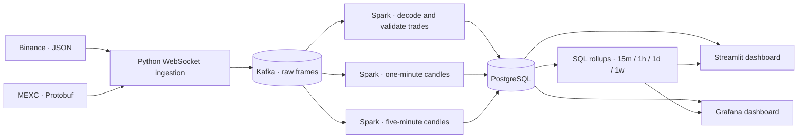

# Declarative Multi-Exchange Analytics Platform

Stream public crypto market data through Kafka and Spark Structured Streaming,
then explore near-real-time prices and market metrics in Grafana or Streamlit.

The platform uses Kafka, Spark Structured Streaming and PostgreSQL, with
Grafana and Streamlit dashboards. Market selection is driven by YAML rather
than separate scripts for each exchange and trading pair. Binance and MEXC spot
trade feeds use public WebSockets; no exchange
account or API key is required.

## What it does

- Captures original exchange messages in Kafka before decoding them.
- Runs concurrent feeds with independent reconnects and shared Kafka publishing.
- Normalizes Binance JSON and MEXC Protobuf into a common trade format in Spark.
- Computes event-time candles with deduplication, late-data handling and
  developing/final status.
- Displays prices, cross-exchange price differences, recent trades, candle
  charts and feed freshness.
- Offers 1m, 5m, 15m, 1h, 1d and 1w candles. Larger intervals are calculated
  from current five-minute snapshots in PostgreSQL, with base-window coverage shown.

Price comparisons use the last observed trades, not executable bid/ask quotes.
This is an analytics project, not a trading bot or an arbitrage execution system.

## How it fits together



Ingestion and each Spark query run independently. The trade query and the two
candle queries read the same raw topic using separate checkpoints. PostgreSQL
stores the results and computes larger rollups from current five-minute candles.
Both dashboards read committed results; neither consumes Kafka or starts Spark.

Kafka, PostgreSQL, Kafka UI and Grafana run in Docker. Ingestion, Spark and
Streamlit run on the host.

## Run locally

### 1. Prepare your environment

The local setup targets macOS with Homebrew. You will need:

- Docker Desktop, running.
- Python 3.11 and OpenJDK 17 installed through Homebrew.
- Make and available local ports: 5432, 8080, 9092, plus 3000 for Grafana
  and/or 8501 for Streamlit.

Java is required by Spark; application code is written in Python. The Makefile
locates Java through Homebrew, so other environments need path adjustments.

From the repository root, create your local configuration and install the
dependencies. Do not overwrite existing configuration if you have already
customized it.

```bash
cp .env.example .env
cp config/feeds.example.yaml config/feeds.yaml
make install
```

### 2. Start the infrastructure

```bash
make infra-up
make db-migrate
make ingestion-plan
```

The first command starts Kafka, PostgreSQL and Kafka UI, and initializes the
topics. The second applies pending database migrations. The last prints the
configured feeds without connecting to an exchange.

### 3. Start the applications

Open four terminals in the repository root. Leave one command running in each:

| Terminal | Command | Purpose |
|---|---|---|
| 1 | `make ingestion` | Capture the configured exchange feeds |
| 2 | `make live-pipeline` | Process and store recent/latest trades |
| 3 | `make candles` | Compute one-minute candles |
| 4 | `make candles CANDLE_INTERVAL=5m` | Compute five-minute candles and supply larger rollups |

Then start Grafana from another terminal; the command returns after launching
its container:

```bash
make grafana-up
```

Open [Market Analytics](http://127.0.0.1:3000/d/market-platform) and
[Kafka UI](http://127.0.0.1:8080). Allow the first Spark batches to complete.
Choose a symbol, exchange and candle interval in Grafana. Changing a selector
reads stored results; it does not start a processing job.

The 15m, 1h, 1d and 1w views require the five-minute query. Days use UTC midnight;
weeks start Monday UTC.
Missing base candles are not filled, and full slot coverage does not prove
complete exchange capture.

For Streamlit, run `make dashboard` in an additional terminal and open
[localhost:8501](http://127.0.0.1:8501). Either dashboard can run alone or both
can run together.

For prices and recent trades only, omit both candle processes. Candle panels
then remain empty or show previously stored results.

### 4. Stop the system

Use `Ctrl+C` in each application terminal, then stop the containers:

```bash
make infra-stop
```

This preserves Kafka and PostgreSQL data. Stopping containers does not stop
host applications, so stop each application terminal too.

## Choose a dashboard

Grafana is the primary interface; Streamlit is a maintained alternative.
Run either or both against the same PostgreSQL results. Neither starts a Kafka
consumer or Spark query.

| Interface | Start | Local address | Stop |
|---|---|---|---|
| Grafana | `make grafana-up` | [Market Analytics](http://127.0.0.1:3000/d/market-platform) | `make grafana-stop` |
| Streamlit | `make dashboard` | [Streamlit](http://127.0.0.1:8501) | `Ctrl+C` in its terminal |

Grafana has symbol and time-range controls. Streamlit uses `DASHBOARD_SYMBOL`.
Both use the same candle tables and SQL rollups.

### Grafana setup

Start PostgreSQL before running `make grafana-up`. No Grafana Cloud account is
needed. The local page allows anonymous viewing. Administration is protected
by a generated password in the ignored,
permission-restricted `.env.grafana` file. Do not expose this local setup to
the internet. Use the setup command rather than starting the container directly.

The dashboard has symbol, exchange and interval selectors, last-trade price
comparisons, candlesticks, volume, coverage and exact-value inspection tables.
It reads the same PostgreSQL results through a dedicated read-only account.
It does not start ingestion or Spark: retained samples can be stale, and the
freshness labels will say so. Adjust the time range to the captured data;
daily/weekly candles may need a wider range to include the bucket's start.
Chart reads are bounded to the latest 200 candles per selection; the time picker
filters that bounded history rather than triggering a historical backfill.

The dashboard and data source are provisioned from `infra/grafana/`. Edit
`scripts/grafana_dashboard.py` and run `make grafana-build` to regenerate the
dashboard; local UI edits are not the source of truth. Grafana reloads the file.
Both interfaces and their tests stay in Git. Check both when changing serving
schemas or metric definitions.

Grafana uses `DASHBOARD_STALE_AFTER_SECONDS` when its dashboard is generated.
Rerun `make grafana-up` after changing that setting. Grafana supports the raw
serving mode only and rejects `SERVING_MODE=canonical`; use Streamlit to inspect
legacy canonical data.

Stopping Grafana preserves its named volume and local credentials. `make infra-stop`
also stops it; `make infra-down` removes containers but preserves named volumes.

## Choose exchanges and markets

Edit `config/feeds.yaml`, which is local and git-ignored:

```yaml
version: 1

exchanges:
  binance:
    transport: websocket
    market_type: spot
  mexc:
    transport: websocket
    market_type: spot

watchlists:
  - name: major-pairs
    exchanges: [binance, mexc]
    pairs: [BTC/USDT, ETH/USDT]
    feeds: [trades]
```

This creates four logical feeds: two pairs across two exchanges. Each feed has
its own WebSocket connection and reconnect supervisor, but they share one
ingestion process and Kafka publishing client.

To change the watchlist:

1. Edit the pairs or supported exchanges.
2. Run `make ingestion-plan` to validate the configuration.
3. Restart ingestion.

There is a limit of 20 feeds per process. Adding a pair does not create a new
broker or a separate Spark job. Adding an unsupported exchange requires a
connector and decoder; a YAML entry alone is not enough.

Validation checks supported settings, pair syntax and duplicate/overlapping
feeds. It does not check whether an exchange currently lists an instrument.
The supported feed is spot trades over WebSockets, not REST polling or order-book
quotes. Configuration changes take effect when ingestion restarts.

For a different configuration file:

```bash
make ingestion FEEDS_CONFIG=path/to/feeds.yaml
```

Operational settings, including connection endpoints, live in `.env`. To change
Streamlit symbol, update `DASHBOARD_SYMBOL` and restart Streamlit. Grafana selects
its symbol interactively from stored market data.

## Useful commands

| Command | What it does |
|---|---|
| `make infra-status` | Check container status |
| `make topics` | Inspect Kafka topics |
| `make spark-consumer-once` | Inspect available input using a separate diagnostic checkpoint |
| `make live-pipeline-once` | Process available trade input, then exit |
| `make candles-once` | Process available candle input, then exit |
| `make candles-once CANDLE_INTERVAL=5m` | Process available five-minute candle input, then exit |
| `make check` | Run formatting, linting, type checks and tests |
| `make proto` | Regenerate the checked-in MEXC Protobuf decoder |

To capture a small sample instead of running ingestion continuously:

```bash
.venv/bin/python -m ingestion.main --max-frames 5
```

This captures up to five market frames per feed. A MEXC frame can contain
multiple trades, so the resulting trade count can be higher. A quiet feed may
take longer to reach its limit.

## Data, recovery and limitations

- **Raw-first capture:** Kafka stores the original market payload in a versioned
  envelope with capture and subscription metadata. Provider decoding happens in
  Spark Python workers, followed by shared validation.
- **Independent recovery:** Trade and candle queries use separate checkpoints.
  PostgreSQL binds output to each query's checkpoint identity and records
  committed batches to make same-history retries safe.
- **Backpressure:** A full Kafka queue retries the same captured frame without
  blocking peer feeds. `KAFKA_ENQUEUE_TIMEOUT_SECONDS` defaults to 10; timeout
  or shutdown with an unqueued frame fails ingestion rather than reconnecting
  and discarding it. There is no durable local outbox.
- **Conflicting trades:** Exact duplicates are safe. Conflicting values for a
  retained trade ID fail the entire serving batch, leaving its output and
  retry marker unchanged. Resolve the input conflict before retrying.
- **Preserve matching state:** Do not delete a checkpoint, change its identity
  or remove database batch markers independently. Use a separate database and
  checkpoint for deliberate replay; never share a checkpoint between writers.
- **Bounded history:** Kafka retention is 24 hours. Recent PostgreSQL trades and
  quarantine rows default to 60 minutes of database residence, pruned on batch
  commits. Candle history has no automatic pruning yet. There is no permanent
  archive or automatic recovery of messages missed during downtime.
- **Event-time finalization:** The default watermark delay is 120 seconds.
  It is a lateness policy, not a dashboard refresh delay. Idle or stopped input
  can leave candles developing; a final candle does not prove complete capture.
- **Local deployment:** One Kafka broker with replication factor one is useful
  for learning, not high availability. Longer-lived candle state and higher feed
  counts need further capacity testing.

Invalid input is quarantined in PostgreSQL by the trade-serving query. The
separate candle query filters invalid rows but does not write its own quarantine.

For schema details, retry rules and design trade-offs, see
[Data contracts](docs/data-contracts.md) and
[Architecture decisions](docs/decisions.md).

<details>
<summary>Existing installations and legacy data</summary>

Run `make infra-up` and `make db-migrate` to initialize missing topics and apply
additive migrations. Existing topics, tables and checkpoints do not need to
be deleted.

The default processing and dashboard mode is `raw`. The older `raw-trades` and
`raw-trades-dlq` topics, `analytics` schema and
`checkpoints/live-market-postgres` are retained legacy state.

To inspect that canonical input explicitly:

```bash
SERVING_MODE=canonical make live-pipeline-once
SERVING_MODE=canonical make dashboard
```

Ingestion always publishes raw frames. `SERVING_MODE` selects processing and
dashboard behavior, not the producer's wire format. Keep legacy checkpoint
history intact; its sink does not have the newer UUID ownership guard.

</details>

<details>
<summary>Optional PostgreSQL integration tests</summary>

These tests create and remove isolated, uniquely named databases rather than
writing into the application's serving tables. Start PostgreSQL first.

```bash
RUN_POSTGRES_INTEGRATION=1 make check
```

</details>

## Repository guide

| Path | Responsibility |
|---|---|
| `config/` | Watchlist example and ignored local feed configuration |
| `ingestion/` | Connectors, feed planning, reconnects and Kafka publishing |
| `processing/decoders/` | Provider JSON/Protobuf decoding and normalization |
| `processing/spark/` | Streaming queries, validation, candle state and sinks |
| `common/` | Shared settings, logging and data contracts |
| `dashboard/` | Streamlit views, charts and database reads |
| `infra/grafana/` | Provisioned Grafana data source and dashboard |
| `scripts/` | Setup, migrations, checks and Grafana dashboard generation |
| `migrations/` | Versioned PostgreSQL schema changes |
| `tests/` | Offline fixtures, unit tests and Spark/database integration tests |
| `docs/` | Contracts, decisions and historical verification notes |

## Stack

Python 3.11 · Kafka 4.3.1 · Spark 4.0.3 · PostgreSQL 17 · Grafana · Streamlit ·
Docker Compose · Kafbat Kafka UI
